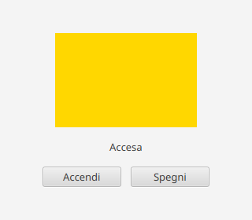

# Esercizio sulle proprietà di JavaFX: la lampadina

In questo esercizio si chiede allo studente di realizzare una lampadina osservabile, in cui due pulsanti permettono di accendere e spegnere un riquadro che cambia colore in base allo stato del modello.
L'obiettivo è collegare il modello e la vista attraverso le proprietà di JavaFX, mantenendo separata la gestione degli eventi dei pulsanti dall'aggiornamento grafico dell'interfaccia.

## Risultato atteso

All'avvio dell'applicazione la lampadina si trova nello stato **spento**. Premendo il pulsante **Accendi**, il riquadro diventa giallo e l'etichetta mostra la scritta "Accesa", mentre premendo **Spegni** viene ripristinato il colore grigio con il testo "Spenta". Se uno stesso pulsante viene premuto più volte consecutivamente, lo stato della lampadina rimane invariato.

| Spenta (stato iniziale) | Accesa |
| --- | --- |
|  |  |

## 1. Completare il modello

Nella classe `Lamp` è già predisposta una `BooleanProperty` inizializzata a `false`:

- Implementare i metodi `turnOn()` e `turnOff()` in modo da aggiornare il valore della proprietà.
- Implementare `onProperty()` restituendo la proprietà osservabile del modello.

Il modello deve rappresentare esclusivamente lo stato della lampadina, senza contenere riferimenti a pulsanti, colori o altri elementi dell'interfaccia grafica.

**Suggerimento:** il valore di una proprietà si legge con `get()` e si modifica con `set(...)`. Il metodo `onProperty()` deve restituire sempre la stessa istanza della proprietà, così che i binding registrati su di essa continuino a osservare i cambiamenti di stato.

## 2. Costruire l'interfaccia grafica

Si completi il metodo `App.start` componendo la finestra con i seguenti elementi:

- Un `Rectangle` di dimensioni 180 × 120 pixel per rappresentare la lampadina.
- Una `Label` per visualizzare lo stato corrente.
- Due `Button`, con testo "Accendi" e "Spegni", larghi almeno 100 pixel.
- Un contenitore `HBox` per affiancare i due pulsanti e un `VBox` per disporre in verticale il riquadro, l'etichetta e i pulsanti.

## 3. Collegare eventi e proprietà

A questo punto occorre collegare l'interfaccia al modello:

- Associare a ciascun pulsante, tramite `setOnAction`, la chiamata al metodo corrispondente di `Lamp`.
- Legare la proprietà `fillProperty()` del riquadro allo stato della lampadina, scegliendo `Color.GOLD` quando è accesa e `Color.DIMGRAY` quando è spenta.
- Legare `textProperty()` dell'etichetta allo stesso stato, alternando i testi "Accesa" e "Spenta".

**Suggerimento:** per far dipendere un valore da una condizione osservabile, JavaFX mette a disposizione `Bindings.when(condizione).then(valoreSeVero).otherwise(valoreSeFalso)`, il cui risultato può essere passato direttamente a `bind(...)` sulla proprietà grafica da aggiornare.

I gestori degli eventi dei pulsanti devono limitarsi a modificare il modello: saranno i binding ad aggiornare automaticamente colore e testo, garantendo la coerenza dell'interfaccia già nello stato iniziale, prima ancora di premere qualsiasi pulsante.

## Verifica

Per avviare l'esercizio dalla cartella principale del progetto, eseguire `./gradlew :javafx-1-property:run` (oppure `.\gradlew.bat :javafx-1-property:run` su Windows), verificando il comportamento nello stato iniziale, l'accensione, lo spegnimento e le pressioni ripetute di ciascun pulsante.
