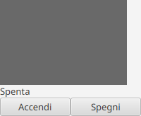

# Esercizio sulle proprietà di JavaFX: la lampadina

Realizzare una lampadina osservabile: due pulsanti accendono e spengono un riquadro, che cambia colore in base allo stato del modello.
L'obiettivo è collegare modello e vista attraverso le proprietà di JavaFX, mantenendo separati gli eventi dei pulsanti dall'aggiornamento grafico.

## Risultato atteso

La lampadina parte **spenta**. Il pulsante **Accendi** rende il riquadro giallo e mostra il testo “Accesa”; **Spegni** ripristina il grigio e il testo “Spenta”. Premere più volte lo stesso pulsante mantiene lo stato corrispondente.

| Spenta (stato iniziale) | Accesa |
| --- | --- |
|  |  |

## 1. Completare il modello

Nella classe `Lamp` è già dichiarata una `BooleanProperty`, inizialmente `false`.

- Implementare `turnOn()` e `turnOff()` modificando il valore della proprietà.
- Implementare `onProperty()` restituendo la proprietà osservabile del modello.
- Il modello deve contenere solo lo stato della lampadina, senza riferimenti a pulsanti, colori o altri elementi della GUI.

**Hint:** una proprietà si legge con `get()` e si modifica con `set(...)`. Il metodo `onProperty()` deve restituire sempre la stessa proprietà, così che i binding continuino a osservare i cambiamenti.

## 2. Costruire la GUI

Completare `App.start` usando:

- un `Rectangle` di 180 × 120 pixel per rappresentare la lampadina;
- una `Label` per il testo dello stato;
- due `Button`, “Accendi” e “Spegni”, larghi almeno 100 pixel;
- un `HBox` per affiancare i pulsanti e un `VBox` per disporre riquadro, testo e pulsanti in verticale.

## 3. Collegare eventi e proprietà

- Con `setOnAction`, collegare ogni pulsante al metodo corrispondente del modello.
- Collegare `fillProperty()` del riquadro allo stato della lampadina: `Color.GOLD` se accesa, `Color.DIMGRAY` se spenta.
- Collegare `textProperty()` della label allo stesso stato, scegliendo tra “Accesa” e “Spenta”.

**Hint:** per ricavare un valore da una condizione osservabile, JavaFX offre `Bindings.when(condizione).then(valoreSeVero).otherwise(valoreSeFalso)`. Il risultato può essere passato a `bind(...)` sulla proprietà grafica da aggiornare.

Gli handler dei pulsanti devono modificare soltanto il modello: il colore e il testo si aggiornano attraverso i binding, anche nello stato iniziale, prima di qualsiasi click.

## Verifica

Avviare dalla root con `./gradlew :javafx-1-property:run` (Windows: `.\gradlew.bat :javafx-1-property:run`).
Controllare lo stato iniziale, l'accensione, lo spegnimento e le pressioni ripetute di ciascun pulsante.
