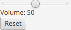
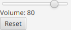

# Esercizio sulle proprietà di JavaFX: il volume

In questo esercizio si chiede di realizzare un regolatore del volume composto da uno slider con valori da 0 a 100, un'etichetta che mostri il livello corrente e un pulsante **Reset**.

Uno **slider** è un controllo grafico costituito da una barra lungo la quale si può trascinare un cursore per scegliere un valore compreso tra un minimo e un massimo, come nei comuni controlli del volume. In JavaFX questo componente è rappresentato dalla classe `Slider`, che mantiene un valore numerico corrente (anche decimale) aggiornato mentre si sposta il cursore. Ai fini dell'esercizio, l'estremo sinistro corrisponde a 0 e quello destro a 100.

All'avvio il volume iniziale è impostato a **50**. Quando l'utente sposta il cursore dello slider devono aggiornarsi sia il valore nel modello sia il testo dell'etichetta, mentre premendo il pulsante **Reset** il volume viene riportato a 50 e anche lo slider deve tornare automaticamente nella posizione corrispondente.

| Stato iniziale e dopo Reset | Dopo aver spostato lo slider |
| --- | --- |
|  |  |

Si chiede allo studente di completare le classi `Volume` e `App` sfruttando le proprietà osservabili di JavaFX per mantenere costantemente sincronizzati il modello e l'interfaccia grafica: gli eventi generati dall'utente devono agire sul modello, mentre l'aggiornamento della vista deve avvenire tramite il meccanismo dei binding.

Per avviare l'applicazione dalla cartella principale del progetto, eseguire `./gradlew :javafx-1b-property-volume:run` (oppure `.\gradlew.bat :javafx-1b-property-volume:run` su Windows), avendo cura di verificare anche più spostamenti consecutivi dello slider alternati a ripetute pressioni del pulsante **Reset**.
