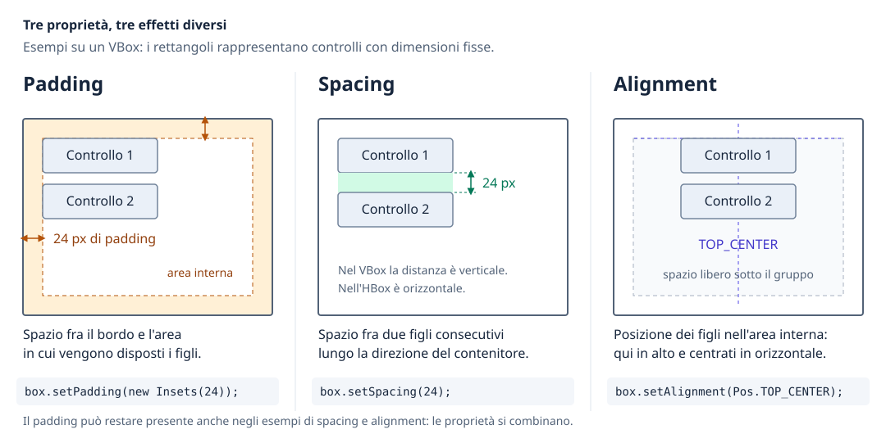
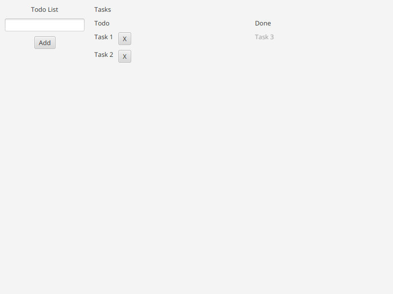

# Esercizio sui layout di JavaFX: la TODO list

Costruire l'interfaccia di una TODO list in due sotto esercizi.
L'obiettivo è comporre i controlli e organizzare i contenitori,
riprendendo le sezioni sui layout e sul dimensionamento delle [slide del corso](https://unibo-lptsi-pss.github.io/22-gui/#/).

I dati sono statici:
i pulsanti **Add** e **X** devono essere visibili, ma
non devono ancora eseguire azioni.
La logica sarà aggiunta nell'esercizio 3.

## 2A — Il form

Completare `createInputPane()` con un titolo “Todo List”,
un campo di testo e un pulsante “Add”, disposti in verticale.
Il form occupa l'area sinistra della finestra mentre l'area centrale resta per ora vuota.

Si chiede allo studente di focalizzarsi prima sull'ordine degli elementi,
e poi di considerare anche spacing e allineamento:

- **Spacing:** distanza fra i componenti figli di un contenitore.
- **Padding:** spazio interno fra il bordo del contenitore e i suoi componenti.
- **Alignment:** posizione dei componenti all'interno dello spazio disponibile.

In JavaFX si configurano con `setSpacing(...)`, `setPadding(new Insets(...))` e `setAlignment(...)`,
sui contenitori che li supportano.

Per il form, usare l'allineamento `Pos.TOP_CENTER`.

**Checkpoint:** titolo, campo e pulsante sono visibili in verticale, separati da spazio e distanziati dai bordi. Il campo accetta testo; premere Add non aggiunge task.

## 2B — Le colonne dei task

Completare `createTasksPane()` nell'area centrale, mantenendo il form della prima tappa. Aggiungere un'intestazione “Tasks” e, sotto, due colonne affiancate:

- **Todo:** intestazione e due task, “Task 1” e “Task 2”. Ogni riga contiene il testo e un pulsante “X”. Completare `createTaskSection(String content)` per costruire entrambe le righe.
- **Done:** intestazione e il testo “Task 3”, disabilitato e senza pulsante.

Inserire i tre task direttamente nel codice. Scegliere come combinare i contenitori per ottenere la struttura mostrata.

**Checkpoint:** le colonne sono affiancate, i task di ciascuna colonna sono in verticale e il testo completato appare disabilitato. I pulsanti X non modificano i task.

Conta la struttura della GUI: non è richiesta una riproduzione esatta delle misure o delle distanze dello screenshot.

## Estensione: ridimensionare la finestra

Allargare e restringere la finestra: quali aree cambiano dimensione? Come si distribuisce lo spazio fra le colonne? Provare a far usare alle due colonne lo spazio orizzontale disponibile, senza ricorrere a coordinate fisse.

Questa parte è facoltativa; i due checkpoint precedenti costituiscono l'esercizio base.

## Avvio

Dalla root: `./gradlew :javafx-2-layouts:run` (Windows: `.\gradlew.bat :javafx-2-layouts:run`).
